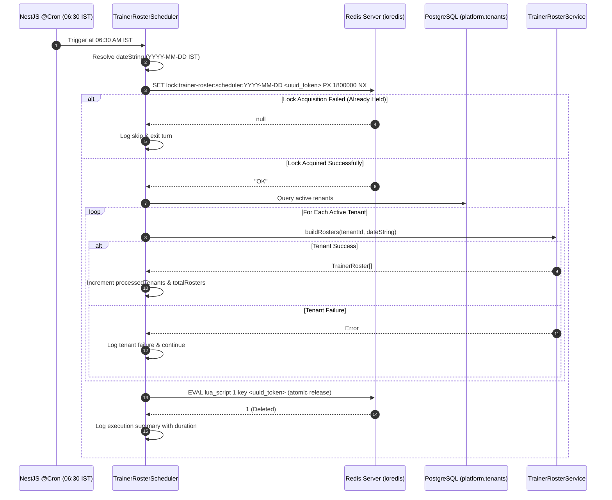

# Technical Design Document: Member A – Trainer Roster Data Pipeline & Scheduler

**Author:** Member A (Senior Backend Architect & Technical Lead)\
**Date:** 2026-11-13\
**Project:** Wellness Studio OS – Cycle 2 B2B\
**Target Branch:** `feature/c2-b2b-trainer-roster`\
**Status:** DRAFT (Phases 1–5 Comprehensive Design)

---

## 1. Problem Statement & Overview

Wellness Studio OS requires an automated, distributed, multi-tenant trainer morning roster pipeline triggered daily at 06:30 AM Indian Standard Time (`Asia/Kolkata`).

The pipeline must:
1. Fire accurately at 06:30 AM IST using NestJS cron scheduling.
2. Prevent duplicate execution across clustered background worker instances using atomic Redis distributed locks with ownership verification tokens.
3. Discover all active tenants dynamically (without hardcoded IDs).
4. For each tenant, invoke `TrainerRosterService.buildRosters(tenantId, date)` inside an isolated PostgreSQL transaction setting tenant context (`app.tenant_id`).
5. Isolate tenant failures so an error in one tenant does not stop or abort processing for subsequent tenants.
6. Record execution duration, tenant success/failure metrics, and structured log output.

---

## 2. Distributed Locking & Concurrency Control



### Distributed Lock Specification
- **Lock Key Pattern:** `lock:trainer-roster:scheduler:${dateString}` (e.g., `lock:trainer-roster:scheduler:2026-11-13`).
- **Token Generation:** `randomUUID()` from `node:crypto`.
- **Atomic Acquisition:** `client.set(key, token, 'PX', ttlMs, 'NX')`.
- **TTL (Time to Live):** 1,800,000 ms (30 minutes). Prevents indefinite lock deadlocks if a worker node crashes mid-execution while allowing ample headroom for large tenant rosters.
- **Ownership-Safe Release:** Atomic Lua check-and-delete:
  ```lua
  if redis.call("get", KEYS[1]) == ARGV[1] then
    return redis.call("del", KEYS[1])
  else
    return 0
  end
  ```
  Ensures that if execution exceeds TTL, Worker A will never delete the lock acquired by Worker B.

---

## 3. Detailed Component Plan (Phase 5)

### 3.1. Files Created and Modified
1. **`backend-worker/src/schedulers/trainer-roster/trainer-roster.scheduler.ts`**:
   Implements `TrainerRosterScheduler` with `@Cron('30 6 * * *', { name: 'trainer-morning-roster', timeZone: 'Asia/Kolkata' })`.
2. **`backend-worker/src/schedulers/trainer-roster/trainer-roster.scheduler.spec.ts`**:
   Isolated unit test suite testing all 13 required scenarios with mocked `RedisClient`, `PrismaService`, and `TrainerRosterService`.
3. **`backend-worker/src/worker.module.ts`**:
   Registers `TrainerRosterScheduler` as an active provider in the NestJS worker application.

### 3.2. Error Handling & Fault Isolation
- **Redis Connection Outage:** If Redis throws during lock acquisition, the scheduler catches the exception, logs a high-severity error, and skips execution without crashing the worker daemon.
- **Tenant Failure Isolation:** Iteration over `activeTenants` wraps each `buildRosters(tenantId, date)` call in an isolated `try/catch` block.
- **Safe Finally Block:** Lock release is guaranteed in a `finally` block, executing only if `token` was non-null.

---

## 4. Test Suite Specification (`trainer-roster.scheduler.spec.ts`)

1. Verify `@Cron` metadata (`30 6 * * *`, name: `'trainer-morning-roster'`, timezone: `'Asia/Kolkata'`).
2. Correct IST date resolution via Phase 3 `getCurrentIstDateString`.
3. Successful distributed lock acquisition with `'NX'` and `'PX'`.
4. Skip execution when lock is held by another worker instance.
5. Safe lock release verifying token ownership with Lua script.
6. Handle Redis connection failures gracefully without throwing unhandled exceptions.
7. Discover and process multiple active tenants sequentially.
8. Isolate single tenant failure without stopping subsequent tenants.
9. Handle zero active tenants gracefully.
10. Dynamic tenant resolution without hardcoded IDs.
11. Pass correct `tenantId` and `dateString` to `TrainerRosterService.buildRosters`.
12. Comprehensive logging of start, completion, duration, and failures.
